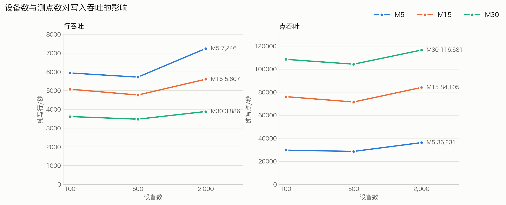
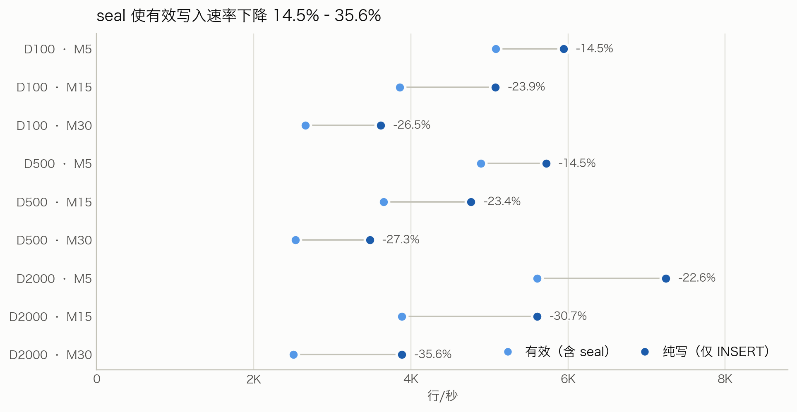
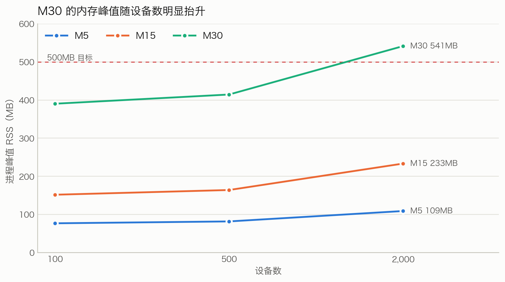
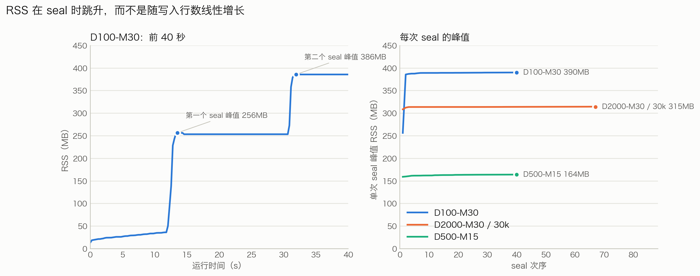
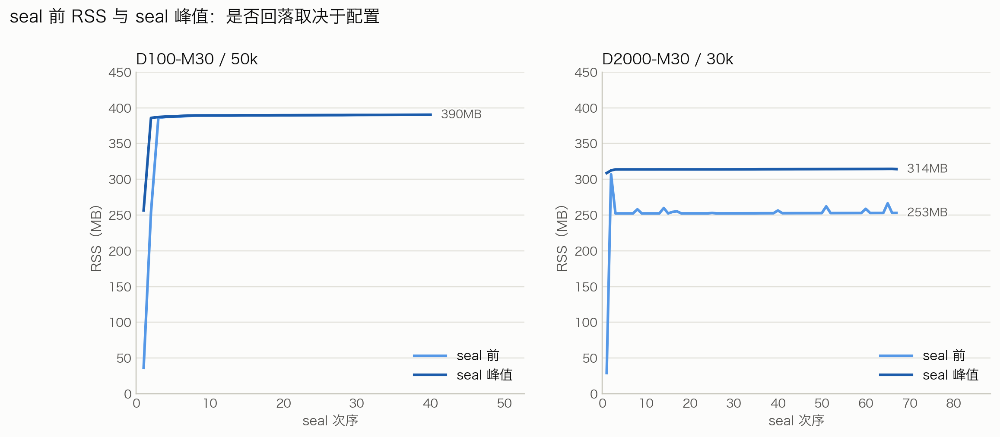
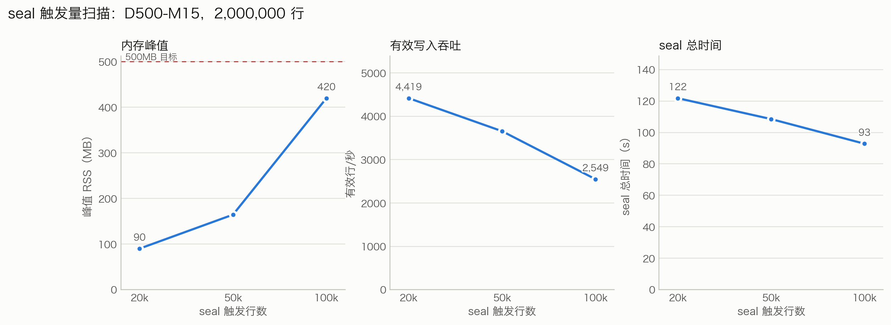
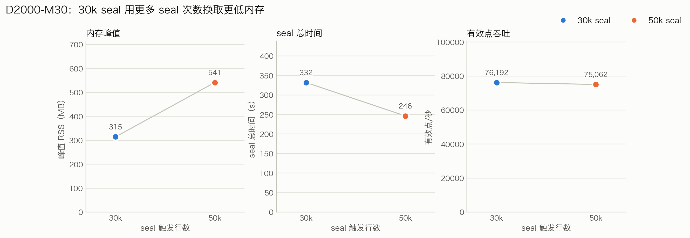

# SQLite + TsFile 树莓派写入/seal 性能报告

日期：2026-11-04  
数据：2026-11-03 在 Raspberry Pi 4B 上单进程运行  
被测对象：`experiment-sqlite` 分支的 SQLite loadable extension `tsfile_hybrid`  
原始数据：results/pi-20261103/  
图表脚本：plot_pi_results.py

> 说明：本文为打印/PDF 版，正文不含超链接；文件路径和脚本名均为纯文本。每张图后面都说明“这图在做什么”和“结论”。

## 1. 摘要

本报告在树莓派上验证 SQLite + TsFile 混合表在固定写入规模下的写入吞吐、seal 开销和内存行为。每个配置写入 **2,000,000 行**，覆盖 100/500/2,000 台设备与 5/15/30 个测点，共 9 个主配置；另外对 D500-M15 做 20k/50k/100k 行 seal 阈值扫描，对 D2000-M30 做 30k 行 seal 补充。

最重要的结论是：**写入吞吐由测点数决定，内存上限由 seal 触发量和行宽决定。** 测点越多，行/秒越低，但点/秒越高；50k 主矩阵中 M30 的纯写点吞吐为 10.4 万–11.7 万点/秒，代价是 390–541MB 的峰值内存；D2000-M30 改用 30k seal 后纯写点吞吐达到 14.4 万点/秒。把 D2000-M30 的 seal 从 50k 降到 30k，峰值从 541MB 降到 315MB，有效点吞吐基本不变，但 seal 总时间从 246s 增加到 332s。

| 指标 | 结果 |
| --- | --- |
| 固定写入规模 | 2,000,000 行/组；M5/M15/M30 分别为 1,000 万/3,000 万/6,000 万点 |
| 主配置数 | 9 组（100/500/2,000 设备 × 5/15/30 测点） |
| 纯写点吞吐（主矩阵） | 28,600–116,581 点/秒；D2000-M30 30k 补充为 143,692 |
| 有效点吞吐（主矩阵） | 24,457–79,795 点/秒 |
| seal 导致的吞吐损失 | 14.5%–35.6% |
| 峰值 RSS | 77–541MB |
| M30 + 2,000 设备 | 50k seal 541MB；30k seal 315MB |

## 2. 测试环境与方法

### 2.1 环境

| 项目 | 配置 |
| --- | --- |
| 机器 | Raspberry Pi 4 Model B Rev 1.5，8GB |
| CPU | Cortex-A72 ×4 @1.8GHz，aarch64 |
| 存储 | microSD 59.5GB，根分区可用约 38GB |
| 系统 | Ubuntu 24.04.4 LTS，内核 6.8.0-1064-raspi |
| Python | 3.12.3 |
| SQLite | 3.45.1，`enable_load_extension` 可用 |
| 扩展 | `/root/tsfile-src/cpp/build/pi/lib/tsfile_sqlite.so` |
| 扩展 SHA256 | `57145b883bc37b3ae75aadc1198b1e6b68e059e4c8f64943c71873fba79a509` |
| 温度/节流 | 测试前 39.9°C；`get_throttled=0x50000`（发生过欠压/节流，当前位为 0） |

### 2.2 负载与配置

每个配置使用一张独立的虚拟表：

```sql
CREATE VIRTUAL TABLE sensor USING tsfile_hybrid(
  time TIMESTAMP TIME,
  device STRING TAG,
  m00000 DOUBLE FIELD,
  ...
  m<N-1> DOUBLE FIELD,
  directory='<workdir>/segments',
  timestamp_precision='ms'
);
```

- 设备数：100 / 500 / 2,000；每设备测点数：5 / 15 / 30。
- 每配置固定写 2,000,000 行；每行包含该设备全部测点。
- 按设备轮转写入，时间戳每设备严格递增；每 1,000 行一个事务，按批尽快写入。
- 不模拟 1Hz 节拍、不模拟多客户端、不执行查询压测。
- 主矩阵 seal 触发量：50,000 行；组末 seal 剩余热行。
- seal 扫描：固定 D500-M15，触发量 20,000 / 50,000 / 100,000 行。
- 补充：D2000-M30 使用 30,000 行 seal。

所有主配置和补充配置的 `status` 均为 `ok`；seal 后热区归零，单设备行数与抽样值校验通过。另有 D100-M5、200,000 行的冒烟运行，用于验证扩展加载、建表、写入、seal 和校验链路。

### 2.3 指标定义

- **纯写**：只统计 INSERT 批次的时间，不包含 seal。
- **有效**：总墙钟时间，包含 seal 停顿；`有效行/秒 = 写入行数 / 总墙钟时间`。
- **峰值 RSS**：测试进程每 250ms 读取 `/proc/self/status` 的 `VmRSS`，取最大值；包括 Python、SQLite 和扩展。
- **seal 峰值**：每次 seal 前后单独记录的 `rss_peak`，用于区分首次 seal 和稳定状态。
- **TsFile 大小**：该配置所有已封存段文件的合计大小；不是单个文件。

本报告的 MB/MiB 均按 1024 换算；RSS 的 MB 与文件大小的 MiB 是同一口径。

## 3. 结果

### 3.1 写入吞吐



*图 1：纯写吞吐（不含 seal）。左：行/秒；右：点/秒。每条线是一个测点档位，横轴是设备数。*

**这图在做什么**：把 9 个主配置按设备数展开，左图比较纯写行/秒，右图比较纯写点/秒。三条线分别是 M5、M15、M30；所有配置都写 200 万行、使用 50k seal，且只统计 INSERT 批次，不包含 seal 时间。

**结论**：测点数越多，行/秒越低，但点/秒越高。M30 的行吞吐约为 M5 的 0.54–0.61 倍，点吞吐约为 M5 的 3.2–3.9 倍。设备数从 100 增至 2,000 没有单调收益；D2000-M5 的纯写行/秒最高，但差异可能包含运行顺序和 SD 卡状态的影响。

图 1 显示两个方向相反的趋势：

- **行/秒随测点数下降**：M5 为 5,720–7,246 行/秒，M15 为 4,765–5,607，M30 为 3,477–3,886。行越宽，单行写入成本越高。
- **点/秒随测点数上升**：M5 为 28,600–36,231 点/秒，M15 为 71,479–84,105，M30 为 104,310–116,581。宽行虽然单行更慢，但每行包含更多测点，总点吞吐更高。

设备数的影响不是单调的：在 M5 三档中，D2000-M5 的纯写行/秒最高（7,246），D500-M5 反而最低（5,720）。这一差异可能来自批大小、SD 卡状态和运行顺序，不能单独归因于设备数。



*图 2：每个配置的纯写与有效行/秒。浅色为有效（含 seal），深色为纯写；右侧数字是 seal 导致的下降比例。*

**这图在做什么**：每个配置画一条哑铃线，左端是有效行/秒（总墙钟时间，包含 seal），右端是纯写行/秒（只统计 INSERT 批次）；右侧标注两者之间的下降比例。线段越长，说明 seal 占用的时间越多。

**结论**：seal 让有效写入速率下降 14.5%–35.6%。M5 为 14.5%–22.6%，M15 为 23.4%–30.7%，M30 为 26.5%–35.6%。测点数越多，seal 的固定开销占比越高；设备数增加到 2,000 时，M30 的下降进一步扩大。

seal 会暂停写入，因此有效速率低于纯写速率。下降幅度从 **14.5%**（D100-M5、D500-M5）到 **35.6%**（D2000-M30）：

- M5：14.5%–22.6%；
- M15：23.4%–30.7%；
- M30：26.5%–35.6%。

下降随测点数增加，因为同样 50k 行，M30 需要编码的 cell 数是 M5 的 4 倍多；设备数增加到 2,000 时，M30 的下降进一步扩大。

| 配置 | 纯写行/秒 | 纯写点/秒 | 有效行/秒 | 有效点/秒 | 峰值 RSS | seal 总时间 | TsFile |
| --- | ---: | ---: | ---: | ---: | ---: | ---: | ---: |
| D100-M5 | 5,942 | 29,708 | 5,081 | 25,406 | 77MB | 46.1s | 71.5MiB |
| D100-M15 | 5,076 | 76,138 | 3,860 | 57,904 | 152MB | 103.2s | 213.0MiB |
| D100-M30 | 3,617 | 108,504 | 2,660 | 79,795 | 390MB | 160.3s | 425.3MiB |
| D500-M5 | 5,720 | 28,600 | 4,891 | 24,457 | 82MB | 48.1s | 77.1MiB |
| D500-M15 | 4,765 | 71,479 | 3,652 | 54,780 | 164MB | 107.1s | 226.5MiB |
| D500-M30 | 3,477 | 104,310 | 2,529 | 75,868 | 415MB | 176.3s | 450.5MiB |
| D2000-M5 | 7,246 | 36,231 | 5,606 | 28,031 | 109MB | 69.9s | 114.6MiB |
| D2000-M15 | 5,607 | 84,105 | 3,883 | 58,250 | 233MB | 138.0s | 324.5MiB |
| D2000-M30 | 3,886 | 116,581 | 2,502 | 75,062 | 541MB | 246.3s | 639.4MiB |

### 3.2 内存



*图 3：50k seal 下各配置的进程峰值 RSS；红色虚线是 500MB 目标。*

**这图在做什么**：固定 50k seal，把 M5、M15、M30 三条曲线按设备数（100/500/2,000）展开，纵轴是进程峰值 RSS；红色虚线标出 500MB 目标。

**结论**：M5/M15 的峰值在 77–233MB，余量充足；M30 为 390–541MB，其中 D2000-M30 超过 500MB。设备数增加会明显抬高 M30 的峰值，100 设备 390MB，2,000 设备 541MB；M5/M15 随设备数的增长则平缓得多。

峰值内存主要由“seal 行数 × 行宽”决定，并叠加设备数开销：

| 测点数 | D100 | D500 | D2000 |
| --- | ---: | ---: | ---: |
| M5 | 77MB | 82MB | 109MB |
| M15 | 152MB | 164MB | 233MB |
| M30 | 390MB | 415MB | **541MB** |

M5/M15 在 50k seal 下有充足余量；M30 在 100/500 设备时接近但未超过 500MB，在 2,000 设备时超过目标。D2000-M30 改用 30k seal 后峰值为 **315MB**。



*图 4：左：D100-M30 前 40 秒的 RSS 轨迹；右：每个配置每次 seal 的峰值 RSS。*

**这图在做什么**：左图展示 D100-M30 在前 40 秒内的实际 RSS 曲线，并标出第一次和第二次 seal 的峰值；右图把每个配置每次 seal 的峰值按 seal 次序画出来，用来观察首次、第二次和后续 seal 的差别。

**结论**：写入阶段 RSS 只缓慢上升；第一次 seal 把 D100-M30 从 36MB 抬到 256MB，第二次到 386MB，之后 38 次 seal 稳定在 387–390MB。只看第一次 seal 会明显低估稳定值（256MB vs 390MB）。右图也说明，D100-M30 在前两次 seal 后很快进入平台，后续 seal 不再继续抬升。

内存不是随累计写入行数线性增长，而是台阶式的：

- 写入阶段 RSS 只缓慢上升：D100-M30 从 14MB 到首次 seal 前 36MB。
- 第一次 seal 把 RSS 抬到 256MB；seal 结束后没有回落到 36MB，而是停在约 253MB。
- 第二次 seal 在已保留的内存基础上继续升到 386MB；之后 38 次 seal 基本维持在 387–390MB。
- 最终的进程峰值是 390MB，但首个 seal 只有 256MB。**做容量评估应看进入平台后的峰值，而不是第一次 seal。**

D500-M15 的 100k seal 也有同样现象：首轮 286MB、第二轮 413MB、之后 415–420MB。首轮峰值会明显低估稳定值。

但“不回落”并不是所有配置都一样。取进入稳态后的各次 seal，比较 seal 前的 RSS 中位数和 seal 峰值中位数：

| 配置 | seal 间稳态 | seal 峰值 | 峰谷差 |
| --- | ---: | ---: | ---: |
| D100-M5 / 50k | 75MB | 76MB | 1.5MB |
| D100-M30 / 50k | 390MB | 390MB | 0MB |
| D2000-M30 / 50k | 536MB | 537MB | 1MB |
| D500-M15 / 20k | 84MB | 88MB | 4.5MB |
| D500-M15 / 100k | 419MB | 420MB | 0MB |
| D2000-M30 / 30k | 253MB | 314MB | 61MB |



*图 5：左：D100-M30 用 50k seal，seal 间稳态几乎贴着峰值；右：D2000-M30 用 30k seal，RSS 在约 253MB 和 314MB 之间循环。*

**这图在做什么**：对比两个配置的“seal 前 RSS”和“seal 峰值”。每个点对应一次 seal：浅色线是下一次 seal 开始前的 RSS，深色线是这次 seal 过程中的峰值。两条线之间的距离，就是 seal 结束后 RSS 能回落多少。

**结论**：D100-M30 / 50k 进入稳态后，两条线几乎重合在 390MB，说明 seal 后基本不回落；D2000-M30 / 30k 的峰值约 314MB、seal 间稳态约 253MB，每次 seal 后回落约 61MB，但不会回到最初的 29MB。因此，“seal 后内存会不会下来”取决于配置：大 seal 往往停在峰值，小 seal 会在较高基座上反复回落。

- 50k 的 M30 和 100k 的 M15 在进入稳态后，seal 前的 RSS 已经接近峰值，所以看起来“升上去就不下来”。
- D2000-M30 / 30k 是例外：前两次 seal 后仍在约 307MB，从第三次 seal 起回落到约 253MB；之后每次 seal 峰值约 314MB，再回落到约 253MB。它确实会下来，但不会回到进程启动时的 29MB。
- M5/M15 的 50k 配置峰谷差只有 1–2MB，绝对值也低（M5 约 76MB，M15 约 151MB）。
- 20k seal 的峰谷差约 4.5MB；100k seal 几乎没有回落。
- 所有配置的稳态都远高于进程启动/首次 seal 前的 13–36MB。进程运行期间，稳态基座不会回到启动值；只有进程退出才彻底释放。
- 这不是无界泄漏：D100-M30 连续 40 次 seal 稳定在 387–390MB，D2000-M30 / 30k 连续 67 次 seal 稳定在 253↔314MB，没有随 seal 次数继续上涨。

从代码看，seal 的 `Row`/`Tablet`/writer 都是局部对象，seal 返回后析构；代码中没有调用 `malloc_trim` 或其他主动归还 RSS 的接口。因此 seal 后 RSS 是否下降，取决于分配器是否把空闲页归还给操作系统，以及 SQLite/写入路径保留了多少缓存；本次测试观察到不同配置表现不同，但没有单独验证每种配置的具体回收原因。

### 3.3 seal 触发量扫描



*图 6：固定 D500-M15、2,000,000 行，比较 20k/50k/100k 行 seal 的峰值 RSS、有效行/秒和 seal 总时间。*

**这图在做什么**：固定 D500-M15 和 200 万行写入量，只改变 seal 触发量（20k、50k、100k）。三个面板从左到右分别展示峰值 RSS、有效行/秒和 seal 总时间，用来观察“seal 频率”对内存、吞吐和 seal 开销的影响。

**结论**：seal 越频繁，峰值内存越低（20k 为 90MB），但固定开销越高：需要 100 次 seal、总时间 121.8s，有效行/秒降到 4,419。100k 只需 20 次、92.8s，但峰值升到 420MB。50k 是中间点：165MB、40 次、108.5s。纯写行/秒在三组间也有波动，可能包含运行顺序和 SD 卡状态影响，不能全部归因于 seal 大小。

| seal 行数 | seal 次数 | 纯写行/秒 | 有效行/秒 | 峰值 RSS | seal 总时间 |
| ---: | ---: | ---: | ---: | ---: | ---: |
| 20,000 | 100 | 6,444 | 4,419 | 90MB | 121.8s |
| 50,000 | 40 | 4,787 | 3,657 | 165MB | 108.5s |
| 100,000 | 20 | 2,987 | 2,549 | 420MB | 92.8s |

seal 越频繁，峰值内存越低，但固定开销越高：

- 20k seal 峰值只有 90MB，但需要 100 次 seal，总时间 121.8s，有效行/秒降到 4,419。
- 100k seal 只需 20 次，总时间 92.8s，但峰值升到 420MB，有效行/秒降到 2,549。
- 50k 是中间点：165MB、40 次、108.5s。

需要注意，纯写行/秒也随 seal 阈值变化（6,444 → 4,787 → 2,987），这不是 seal 本身造成的，可能包含运行顺序、SD 卡状态和节流影响；因此不要把三组的纯写差异全部归因于 seal 大小。有效行/秒的下降同时包含 seal 停顿和这些环境因素。

### 3.4 D2000-M30：30k 与 50k 的权衡



*图 7：D2000-M30 在 30k 和 50k seal 下的峰值 RSS、seal 总时间和有效点/秒。*

**这图在做什么**：固定 D2000-M30 和 200 万行写入量，对比 30k 与 50k 两种 seal 触发量。三个面板分别看峰值 RSS、seal 总时间和有效点/秒，用来说明降低 seal 触发量在内存、时间和吞吐之间的取舍。

**结论**：30k 把峰值 RSS 从 541MB 降到 315MB，满足 <500MB 目标；有效点/秒为 76,192，与 50k 的 75,062 基本持平。代价是 seal 次数从 40 增到 67、seal 总时间从 246s 增到 332s，TsFile 合计从 639.4MiB 增到 801.1MiB。对 2,000 设备、M30 的场景，30k 是更稳妥的选择。

| seal 行数 | seal 次数 | 纯写点/秒 | 有效点/秒 | 峰值 RSS | seal 总时间 | TsFile |
| ---: | ---: | ---: | ---: | ---: | ---: | ---: |
| 30,000 | 67 | 143,692 | 76,192 | **315MB** | 331.9s | 801.1MiB |
| 50,000 | 40 | 116,581 | 75,062 | **541MB** | 246.3s | 639.4MiB |

把 seal 从 50k 降到 30k：

- 峰值 RSS 从 541MB 降到 315MB，满足 <500MB 目标；
- 30k 的 seal 间稳态约 253MB、峰值约 314MB，RSS 在两者之间循环；50k 的稳态约 536MB、峰值 541MB，几乎不回落；
- 有效点/秒从 75,062 到 76,192，基本持平（约 +1.5%，在单次运行波动范围内）；
- 代价是 seal 次数从 40 增加到 67，seal 总时间从 246s 增加到 332s（+35%）；
- TsFile 合计从 639.4MiB 增加到 801.1MiB（+25%）；段文件数从 40 增到 67，更多分段会带来额外的元数据和编码开销。

### 3.5 存储规模

每个配置写 2,000,000 行后，TsFile 段文件合计大小如下（MiB）：

| 测点数 | D100 | D500 | D2000 |
| --- | ---: | ---: | ---: |
| M5 | 71.5 | 77.1 | 114.6 |
| M15 | 213.0 | 226.5 | 324.5 |
| M30 | 425.3 | 450.5 | 639.4 |

SQLite 热表本身很小：DB 为 5.5–16.6MiB，WAL 为 5.5–19.6MiB，两者合计 10.9–36.1MiB。写入 200 万行后，绝大部分数据已经在 TsFile 冷段中，热区在组末 seal 后归零。

## 4. 讨论

### 4.1 为什么行/秒下降、点/秒上升

每行包含 `2 + N` 个值（时间、设备 TAG、N 个 FIELD）。N 增大时：

- 单行的值数量和编码工作量增加，所以行/秒下降；
- 每行携带的测点数增加，所以点/秒上升。

在 50k 主矩阵中，M30 的纯写点吞吐约为 M5 的 3.2–3.9 倍，而行吞吐只有 M5 的 0.54–0.61 倍。这个权衡适合“设备数有限、每设备测点多”的场景；如果设备数很多而每设备测点少，行吞吐更重要。

### 4.2 内存要看稳定 seal 峰值

RSS 曲线是台阶式的：写入阶段增长缓慢，seal 时跳升，首轮 seal 后分配器保留内存，第二轮可能继续抬升，之后进入平台。D100-M30 的首轮 seal 峰值 256MB，稳定值 390MB；D500-M15 的 100k seal 首轮 286MB，稳定值 420MB。只看第一次 seal 会低估 30%–50%。

“进入平台”不等于所有配置都停在峰值：50k 的 M30 稳态几乎等于峰值（D100-M30 约 390MB，D2000-M30 约 536MB），所以看起来 seal 后完全不回落；D2000-M30 / 30k 则在约 253MB 和 314MB 之间循环，每次 seal 后能回落约 61MB，但不会回到最初的 29MB。做容量规划时，既要知道峰值，也要知道稳态；常驻进程的 RSS 通常就是这两者中的较高水平。

因此容量规划应以“进入平台后的 seal 峰值”为准，并留出设备数增加带来的元数据余量。D2000-M30 的 541MB 就是一个例子：同为 M30，100 设备时 390MB，2,000 设备时 541MB。

### 4.3 seal 频率的取舍

seal 频率同时影响三件事：

- **内存峰值**：seal 行数越少，峰值越低；
- **有效吞吐**：seal 越频繁，固定开销占比越高；
- **文件数量与存储开销**：seal 越频繁，段文件越多，TsFile 总大小越大（D2000-M30 30k 比 50k 多 25%）。

没有一组参数对所有场景都最优。对内存受限的设备，优先保证峰值；对吞吐和存储更敏感的场景，可以适当增大 seal 触发量。

## 5. 建议

以 **<500MB 峰值内存** 为目标：

- 100/500 设备、M5/M15/M30：50k seal 均可，M30 峰值 390/415MB，余量较小但未超限。
- 2,000 设备、M5/M15：50k seal，峰值 109/233MB，余量充足。
- 2,000 设备、M30：使用 **30k seal**，峰值 315MB；如果更看重吞吐和存储，可接受 541MB 时再用 50k。
- 内存非常紧张时可用 20k seal，但要知道它会带来约 100 次 seal 和更高的固定开销；D500-M15 的 20k 峰值为 90MB。

容量评估时同时看“平台峰值”和“seal 间稳态”，不要用首轮 seal 峰值；同时把 Python/SQLite/扩展的基线内存（本测试约 14–36MB）计入总量。常驻进程的 RSS 会停在这个平台或循环区间，不会自动回到启动值；如果必须压低常驻内存，可以考虑更小的 seal 触发量、在 seal 后调用 `malloc_trim`（glibc 专用，当前未实现）或重启进程，但都需要实测吞吐代价。

## 6. 局限

- 每组只运行一次，绝对值受 SD 卡状态、温度和运行顺序影响；应看趋势和数量级，不宜当作精确上限。
- 测试前 `get_throttled=0x50000` 表明 Pi 发生过欠压/节流；当前位为 0，但历史节流可能影响部分结果。
- RSS 每 250ms 采样一次，瞬时峰值可能略高于记录值。
- 吞吐包含 Python 驱动、SQLite 热表和 SD 卡成本，不是扩展的纯 C++ 上限。
- 只测单连接、同步写入；没有并发客户端、查询压测或 latest/range 查询负载。
- TsFile 大小是每个配置所有段文件的合计，不是单个文件；不同 seal 阈值会产生不同文件数，比较时需注意。

## 7. 复现与数据

- 原始 JSON（每组含 `rss_samples`、逐次 seal 记录、批次延迟、文件大小和校验结果）：results/pi-20261103/
- 汇总表：PI_RESULTS.md、PI_RESULTS.csv
- 测试脚本：pi_write_seal_bench.py、run_pi_matrix.sh
- 图表脚本：plot_pi_results.py
- 图表矢量版：`figures/*.svg`

在树莓派上重新生成图表：

```bash
python3 cpp/src/sqlite/bench/plot_pi_results.py
```
